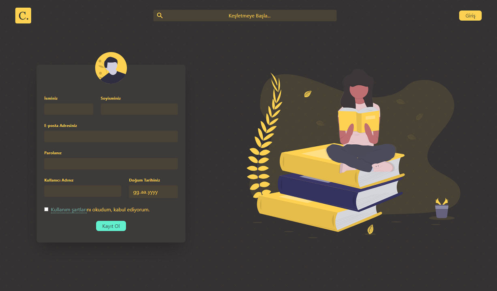

<h1 align="center">
   
  
   
   
   
</h1>

<h1 align="center">
  
</h1>

> Cemiyet Frontend Repository

## Development entry

**Full interface/component design in FigCraft comes before product frontend code.** The illustration above is an existing repository asset, not evidence of a completed design gate.

Start with [local development documentation](docs/index.md), [design plan](docs/design/plan.md), [design progress](docs/design/progress.md) and [task queue](.scratch/architecture-roadmap/spec.md). Only full-design task 01 is currently actionable; implementation foundation task 18 and feature code wait for complete design coverage. The existing React/Vite shell is preserved.

Local [architecture](docs/architecture/system.md), [vocabulary](GLOSSARY.md) and [product scope](docs/planning/product-scope.md) supply development context without another checkout or the public documentation site.
